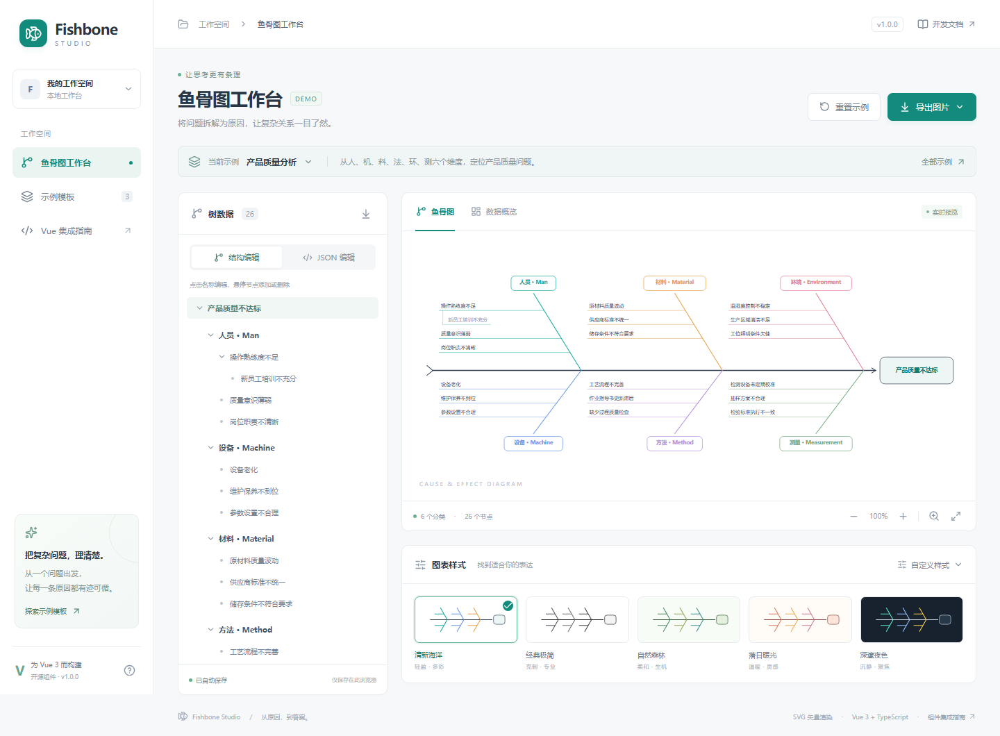

# Fishbone Studio

Vue 3 鱼骨图组件库及中文演示工作台。树结构转为 SVG 鱼骨图，支持主题定制和 PNG / JPEG / WebP / SVG 下载。



## 快速开始

需要 Node.js **22.12+**（建议 Node.js 24 LTS）及 npm。

```powershell
cd D:\WorkProject\FishboneStudio
npm install
npm run dev
```

打开 http://127.0.0.1:5173 。端口固定为 5173，如被占用先停止已有进程。

```sh
npm run check        # 类型检查、单元测试、生产构建及独立包 ESM/CJS/SSR 验证
npx playwright install chromium
npm run test:e2e     # 实际浏览器：编辑、主题、存储、四种图片编码、移动端
```

## Demo 功能

- 三组示例：产品质量分析（6M）、项目延期复盘、用户流失分析。
- 结构编辑：修改名称（失焦后应用）、添加任意层子节点、删除节点、折叠分支。
- JSON 编辑：粘贴或修改完整树结构，点击「应用数据」后校验。错误输入不会覆盖当前图表。
- 五套主题及背景、主骨、文字、分支颜色、字体大小、线宽、圆角定制。
- 画布缩放、全屏、数据概览、JSON 下载、图片导出倍率与质量设置。
- 自动保存到当前浏览器的 localStorage，刷新后恢复；「重置示例」恢复选中的内置示例。
- Vue 集成代码展示和复制；桌面及移动端响应式布局。

## 在其他 Vue 项目中安装

包已按 npm 发布结构构建，目前为本地组件包，不需要发布到注册表即可集成：

```sh
npm run build -w @fishbone/vue
npm pack -w @fishbone/vue
# 在你的 Vue 项目中安装生成的包（替换为实际文件路径）
npm install D:/WorkProject/FishboneStudio/fishbone-vue-1.0.0.tgz
```

生成 ESM / CommonJS 两种构建和 TypeScript 声明。Vue 是 peer dependency，不会被打进组件库；无需额外引入 CSS。

```vue
<script setup lang="ts">
import { ref } from 'vue'
import { FishboneDiagram } from '@fishbone/vue'
import type { FishboneNode, FishboneHandle } from '@fishbone/vue'

const diagram = ref<FishboneHandle | null>(null)
const data: FishboneNode = {
  label: '项目交付延期',
  children: [
    { label: '需求', children: [{ label: '需求变更', children: [{ label: '缺少变更评估' }] }] },
    { label: '资源', children: [{ label: '人力不足' }] }
  ]
}
async function save() {
  await diagram.value?.download({ format: 'png', scale: 2, filename: '项目分析' })
}
</script>

<template>
  <FishboneDiagram
    ref="diagram"
    :data="data"
    preset="ocean"
    :theme="{ fontSize: 16, spineColor: '#138b7c' }"
    @error="console.error"
  />
  <button @click="save">下载 PNG 图片</button>
</template>
```

全局安装：

```ts
import FishbonePlugin from '@fishbone/vue'
app.use(FishbonePlugin)
```

## 组件 API

| Prop     | 类型                     | 默认值  | 说明                                                   |
| -------- | ------------------------ | ------- | ------------------------------------------------------ |
| `data`   | `FishboneNode`           | 必传    | 根节点为问题，一级节点为原因分类，后续节点为分层原因   |
| `preset` | `FishbonePreset`         | `ocean` | `ocean` / `classic` / `forest` / `sunset` / `midnight` |
| `theme`  | `Partial<FishboneTheme>` | `{}`    | 覆盖当前主题中的任意样式项                             |

```ts
interface FishboneNode {
  id?: string
  label: string
  children?: FishboneNode[]
}

interface FishboneTheme {
  background: string
  spineColor: string
  branchColors: string[]
  textColor: string
  mutedColor: string
  headBackground: string
  headTextColor: string
  fontFamily: string
  fontSize: number
  lineWidth: number
  nodeRadius: number
}
```

颜色可传 CSS 颜色值，透明背景使用 `background: 'transparent'`；`branchColors` 会循环分配到分类。`fontSize` 上限 40、`lineWidth` 上限 12、`nodeRadius` 上限 40。

| Ref 方法                | 返回值          | 说明                              |
| ----------------------- | --------------- | --------------------------------- |
| `getSvg()`              | `string`        | 获取独立 SVG 源码                 |
| `exportImage(options?)` | `Promise<Blob>` | 生成图片 Blob，方便上传或自行处理 |
| `download(options?)`    | `Promise<void>` | 生成图片并触发浏览器下载          |

| 导出参数     | 默认值     | 说明                                       |
| ------------ | ---------- | ------------------------------------------ |
| `format`     | `png`      | `png` / `jpeg` / `webp` / `svg`            |
| `filename`   | `fishbone` | 文件名，自动追加扩展名、清理非法文件名字符 |
| `scale`      | `2`        | 位图尺寸倍率，范围 0.1–4，SVG 始终为矢量   |
| `quality`    | `0.92`     | JPEG / WebP 编码质量，范围 0–1             |
| `background` | 图表背景   | 导出背景覆盖；透明 JPEG 自动垫白           |

事件：`error(Error)` 在数据、主题或导出失败时触发；`exported(Blob)` 在 `exportImage()` 成功时触发。导出异常仍会 reject，调用方应捕获。

## 独立渲染与服务端

```ts
import { renderFishboneSvg, validateTree, exportSvgImage } from '@fishbone/vue'

validateTree(data)
const svg = renderFishboneSvg(data, 'forest', { fontSize: 16 })
// 浏览器端将 SVG 编码成图片
const blob = await exportSvgImage(svg, { format: 'webp', quality: 0.9 })
```

`renderFishboneSvg` 为不依赖 DOM 的纯函数，支持服务端渲染。标签与样式属性均进行 XML 转义。`exportSvgImage` / `downloadSvgImage` 也可独立导入；位图编码与下载需要浏览器。

## 数据与图片边界

- 支持最多 **500 个节点、12 层、单节点 120 个 Unicode 字符**，防止异常数据导致布局失控；拒绝循环和重复对象引用。
- 长文字自动换行，布局随节点数量增高、随分类数量和深度增宽。根节点没有 children 时仍能显示问题。
- 大图建议使用 SVG；位图每边最多 16,384 像素、总计最多 3,200 万像素，超出时提示降低倍率。
- PNG / JPEG / WebP 使用浏览器原生 Canvas 编码；浏览器不支持某种格式时明确报错。JPEG 不支持透明度。
- 字体使用当前系统字体；跨设备显示可能有少量差异。导出会等待浏览器字体就绪，SVG 文件保留字体族而不嵌入字体。

## 目录

```text
packages/vue/       可独立分发的组件库
  src/layout.ts     树结构布局
  src/svg.ts        安全的独立 SVG 序列化
  src/export.ts     图片编码与下载
apps/demo/          Vite + Vue 3 演示工作台
tests/              单元及浏览器集成测试
```

MIT License。
